# ROADLINE '95

A circuit racing game for the browser in the style of the mid-1990s racers: the first texture-mapped 3D worlds, SVGA 640×480 in 256 colors, Gouraud shading, sprite trees and spectators, tracker music. Every pixel of the 3D world is an index into one 256-color palette, textures are point-sampled and affine-mapped (with the characteristic "swimming"), and light and fog go through a colormap, just like in the software engines of the era. Pure JavaScript and WebGL2: no libraries, no build dependencies, no image or audio files.

**▶ Play: https://noneawe.github.io/roadline95/**

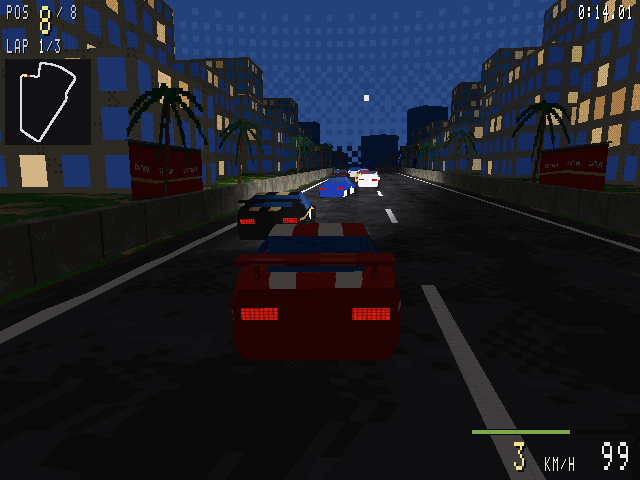

## Screenshots

| | |
|---|---|
| 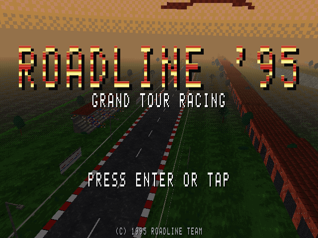 | 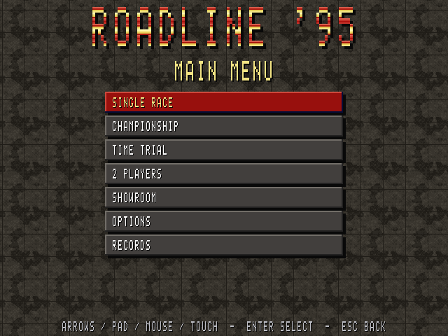 |
| Title screen: a flyover rendered by the engine, logo with color cycling | Mid-90s menus with a textured background |
| 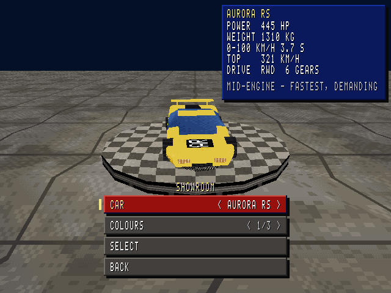 | 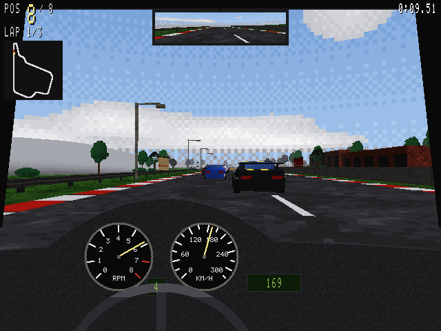 |
| Showroom: six fictional cars, spec card, three color sets | Cockpit with needle gauges and a rear-view mirror |
| 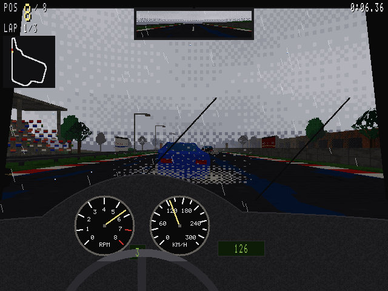 | 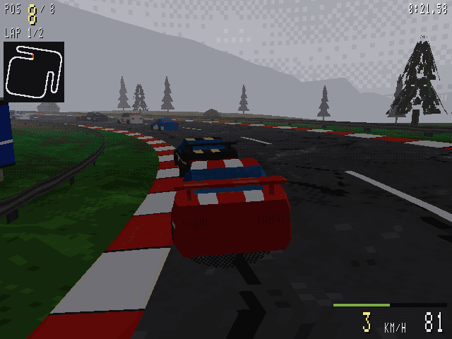 |
| Rain: wipers, drops, wet asphalt, spray, less grip | Fog through the colormap, never smooth blending |
| 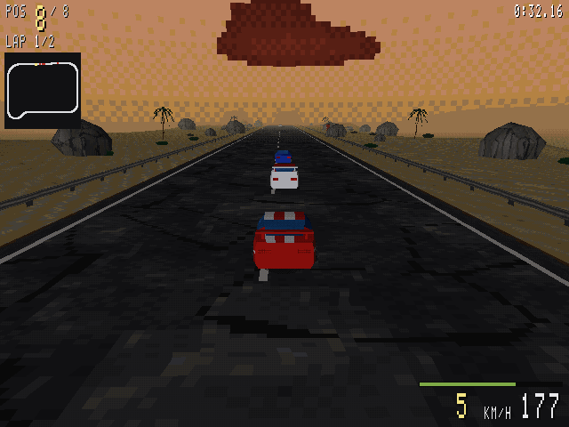 | 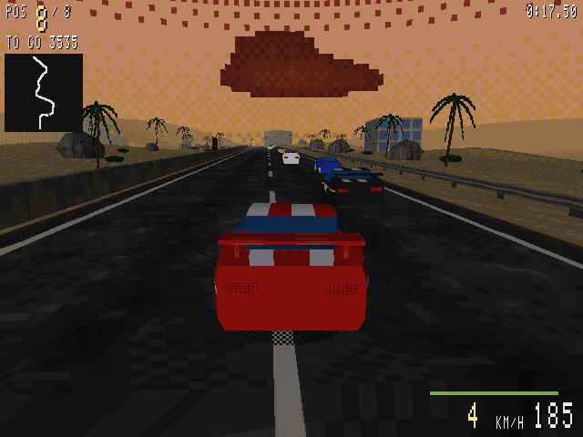 |
| Mirage Highway at dusk | Cliffside Run, a point-to-point sprint |
| 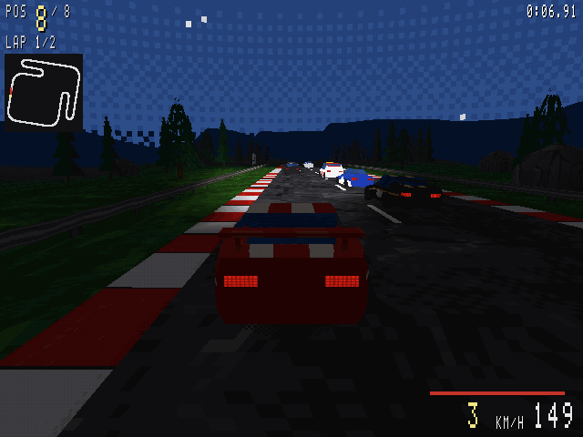 | 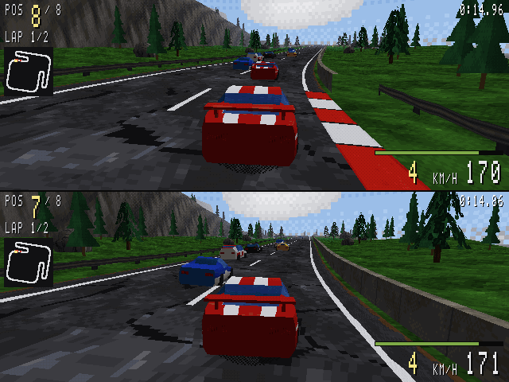 |
| Night with dithered headlight cones | Two players on a split screen |
| 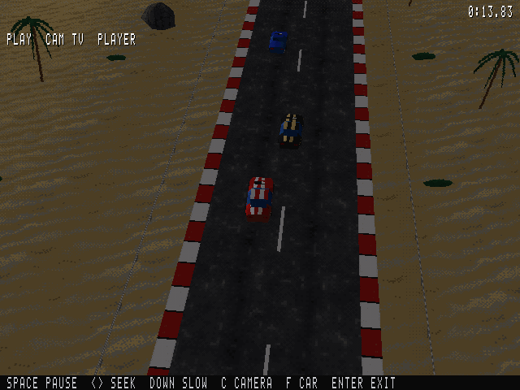 | 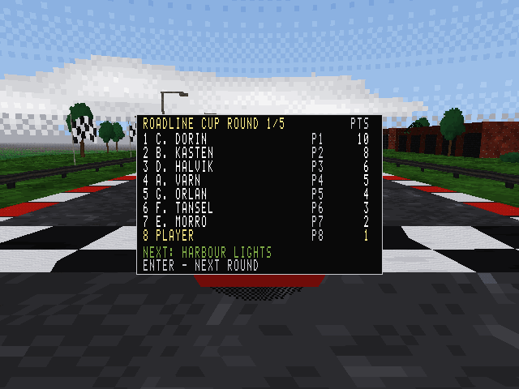 |
| TV-style replay with trackside and helicopter cameras | Championship standings after a round |

## Features

- **Five tracks:**

  | Track | Type | Setting |
  |---|---|---|
  | Harbour Lights | circuit, about 3.9 km | harbour city at night, tunnel under the hill, bridge over the basin |
  | Greywater Raceway | circuit, about 4.6 km | race circuit with a pit lane, hairpin, esses, creek bridge |
  | Highcrest Loop | circuit, about 4.2 km | mountain switchbacks, two tunnels, gorge bridge, 60 m of climb |
  | Mirage Highway | circuit, about 5.8 km | wide desert highway, rock tunnel, dry river bridge |
  | Cliffside Run | sprint, 4.3 km | coastal road over headlands, two tunnels, bay bridge |

- **Six fictional cars:**

  | Car | Character |
  |---|---|
  | Vektor GT2 | wedge coupé, all-rounder |
  | Aurora RS | mid-engine supercar, fastest, demanding (unlocked by winning the championship) |
  | Breeze Turbo | light roadster with turbo lag |
  | Kestrel ST | 4×4 sports sedan, best in the rain |
  | Halcyon V12 | heavy GT, huge torque, lazy steering |
  | Mistral Rally | rally hatchback, quick off the line, low top speed |

- **Modes:** single race against up to 7 AI rivals, a 5-round championship with standings, time trial against the ghost of your best lap, 2 players on a split screen.
- **Rivals:** seven drivers with their own cars, liveries and personalities (pace, aggression, mistakes), overtaking and defending, slipstream.
- **Physics:** arcade-sim in the mid-90s spirit: torque curves, turbo lag, 5–6 gears (automatic or manual), RWD/AWD, per-wheel tyre model, weight transfer, downforce, kerbs, grass and gravel, banking and slopes, car-to-car collisions, visual damage (dents, scratches, broken lights).
- **Time of day and weather:** day, dusk and night (headlights, lit windows, street lamps); rain (wipers, drops, spray, wet asphalt, less grip) and fog.
- **Cameras and replays:** cockpit with a mirror, bumper, chase and far cameras; a full-race replay with TV cameras, zoom, helicopter shots, pause, rewind and slow motion.
- **Sound:** procedurally generated samples, an rpm-crossfaded engine per car, Doppler on rivals, tunnel reverb, and four original songs played by a built-in MOD/S3M-style tracker (radio during the race).
- **Menus and options:** title screen, showroom with a 3D podium, detail options that apply immediately (resolution 640×480/320×240, flat textures, perspective correction, draw distance, scenery density, detailed cars, mirror), sound, controls, difficulty, km/h or mph, assists; lap and track records and championship history saved in the browser.
- **Mobile:** touch buttons or tilt steering, fullscreen and landscape lock.

## Controls

| Action | Player 1 | Player 2 (split screen) | Gamepad |
|---|---|---|---|
| Throttle / brake | ↑ / ↓ (or W / S alone) | W / S | RT / LT |
| Steer | ← → (or A D alone) | A D | left stick |
| Handbrake | Space | left Shift | A |
| Gear up / down (manual) | . / , | E / Q | RB / LB |
| Camera | C | 1 | Y |
| Look back | V | 2 | R3 |
| Radio | R | – | Select |
| Pause menu | Esc | Esc | Start |

Replay (Space on the results screen): Space pause, ←/→ hold to seek, ↓ slow motion, C camera, F followed car, Enter exit. Menus work with the arrows and Enter/Esc, a gamepad, the mouse or touch. On phones, on-screen buttons appear after the first touch. The audio starts after the first key press, click or touch.

## Running locally

Requirements:

- a browser with WebGL2;
- Node.js 18+ (only for the tests and the build; there are no npm packages);
- any static HTTP server (ES modules do not load from `file://`).

```bash
python3 -m http.server 8080
# game:           http://localhost:8080/index.html
# render tests:   http://localhost:8080/tests/render.html
# texture viewer: http://localhost:8080/tests/textures.html

node tools/test.mjs          # logic tests (node:assert)
node tools/render-test.mjs   # render tests in headless Chrome against tools/golden/
node tools/build.mjs         # single-file build: dist/roadline95.html, also works from file://
```

Useful URL parameters (any race parameter skips the menus and starts a race):

| Parameter | Effect |
|---|---|
| `?track=2` | track: 0 harbour, 1 raceway, 2 mountain, 3 desert, 4 coast sprint |
| `?mode=champ` | `race`, `champ` (championship) or `time` (time trial) |
| `?car=1` / `?color=2` | car (0–5) and color set (0–2) |
| `?players=2` | split screen (`&car2=`, `&color2=` for player 2) |
| `?ai=3` / `?laps=1` | number of rivals, number of laps |
| `?time=night` | `day`, `dusk`, `night` |
| `?weather=rain` | `clear`, `rain`, `fog` |
| `?detail=low` | 320×240 |
| `?persp=1` | perspective-correct textures instead of affine mapping |
| `?debug=1` | debug overlay (FPS, triangles, draw calls), F1–F7 debug keys |
| `?rawpal=1` | show the palette index buffer as grayscale |
| `?wire=1` | wireframe mode |
| `?mute=1` | audio muted |

More parameters and the full technical specification are in [CLAUDE.md](CLAUDE.md).

## How it works

1. **3D passes into an index buffer.** The world renders into an `R8UI` 640×480 (or 320×240) texture holding palette indices. The palette has 16 ramps of 16 levels.
2. **Indexed textures.** About 70 textures (including the 128×128 car liveries) and the sky panoramas are generated from a seed at start-up and stored as palette indices in a texture array, sampled with `texelFetch` (no filtering, no mipmaps; a simplified 32×32 variant serves far away).
3. **Affine mapping.** UVs are interpolated linearly in screen space, like the software rasterizers of the time; large polygons are subdivided to keep the "swimming" small. F3 toggles perspective correction.
4. **Colormap.** Light (32 levels) and fog (8 levels) are dithered with a 4×4 Bayer matrix in the index buffer's own pixel grid and applied through a 256×256 index→index table, so nothing is ever blended outside the palette. Headlights are light cones computed per vertex.
5. **Binary transparency only.** Sprites and cutouts use index 0 as a hole; rain, spray and the ghost car are drawn as checkerboards.
6. **CPU overlay and present.** The cockpit, HUD, menus and rain are drawn on the CPU into a byte overlay; a final pass combines it with the world, looks the indices up in the palette and scales the picture into a 4:3 letterbox with nearest-neighbour sampling.
7. **Assets in code.** Models, textures, the font, the sound samples and the music are all generated or defined in code; the whole game builds into one HTML file of about 530 KB.

The project was developed in ten stages; their scope, the rules and the known issues are in [CLAUDE.md](CLAUDE.md) and [CHANGELOG.md](CHANGELOG.md).

## Project layout

```
src/
  main.js, config.js, storage.js
  engine/   loop, input (keyboard, gamepads, touch, pointer, menu navigation), math, RNG, debug
  gfx/      WebGL2 renderer, palette, colormap, texture array, meshes, overlay, font, shaders
  texgen/   procedural textures, sky panoramas, car liveries
  world/    track, terrain, scenery, chunks, racing line, ground queries
  vehicle/  physics, tyres, drivetrain, damage, car specifications
  ai/       rivals
  game/     race logic, race simulation, collisions, replay, ghost, championship, records, weather
  audio/    mixer, sample generator, engine sound, effects, tracker and songs
  camera/, cockpit/, models/, data/ (tracks, zones, season), state/ (screens and game flow)
tools/      build.mjs, test.mjs, render-test.mjs, golden render images (.bin)
tests/      render.html (browser render tests), textures.html (texture viewer)
site/       landing page of the GitHub Pages site
```

## Status and known issues

- **Testing so far.** All ten stages are implemented. They were tested with 84 logic tests, 30 render tests, scripted sessions in headless Chromium and frame-time measurements on an Intel UHD 630.
- **Not yet verified.** Real phones and gamepads, and listening to the sound and music by ear.
- **Full list.** See the "Known issues" sections in [CHANGELOG.md](CHANGELOG.md).

## License

Copyright (C) 2026 the ROADLINE '95 authors.

This program is free software: you can redistribute it and/or modify it under the terms of the GNU Affero General Public License as published by the Free Software Foundation, either version 3 of the License, or (at your option) any later version. See [LICENSE](LICENSE).

All cars, drivers, places, brands and music in the game are fictional and original.
